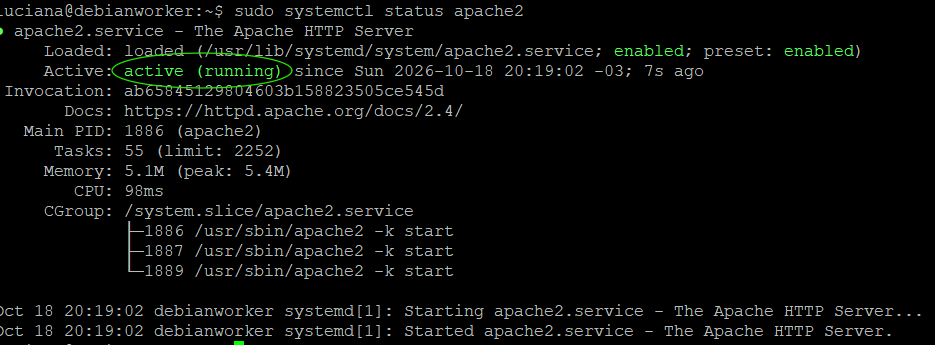
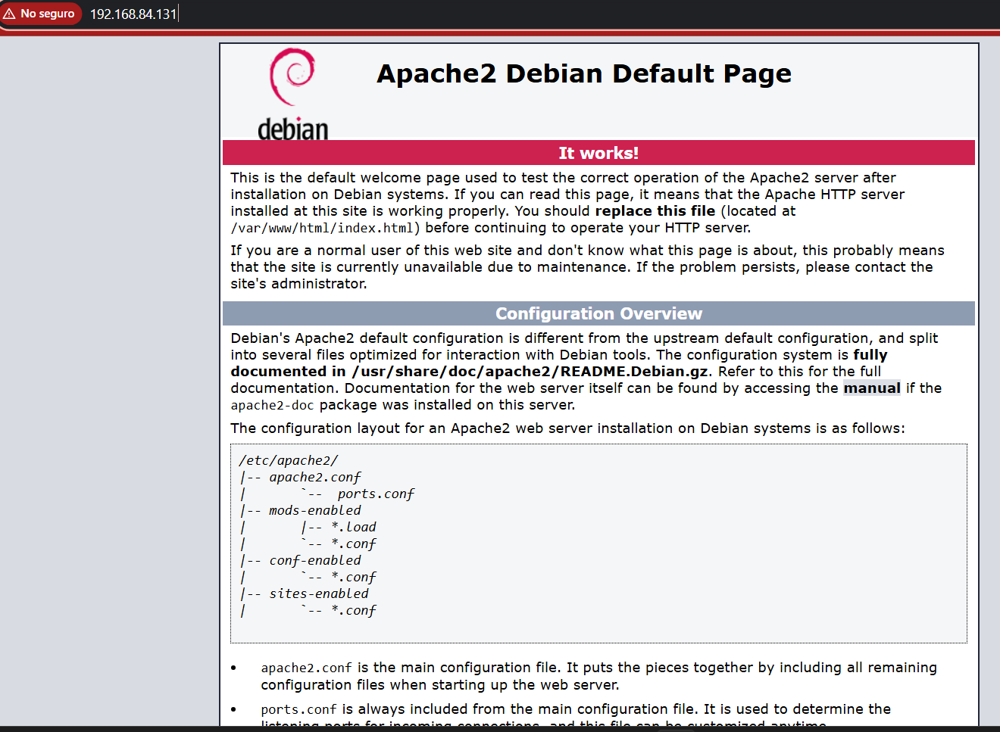
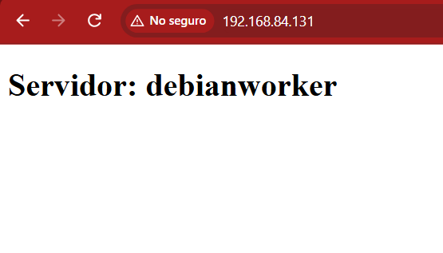
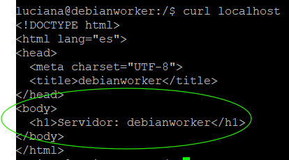

# Apache: página estática que muestra el nombre del servidor
Objetivo: Instalar Apache en Debian 13 y servir una página HTML estática que muestre el nombre del servidor.

## Pasos

1. Descargar la lista más reciente de programas disponibles:
```bash
   sudo apt update
```
2. Instalar Apache:
```bash
   sudo apt install -y apache2
```
3. Confirmar que está corriendo (debe decir `active (running)`):
```bash
   sudo systemctl status apache2
```
   
   
4. Probar desde el navegador del host, con la IP de la VM: `http://192.168.84.131`

   
5. Crear el index.html con el nombre del server:
```bash
   sudo tee /var/www/html/index.html > /dev/null <<EOF
    <!DOCTYPE html>
    <html lang="es">
    <head>
    <meta charset="UTF-8">
    <title>$(hostname)</title>
    </head>
    <body>
    <h1>Servidor: $(hostname)</h1>
    </body>
    </html>
    EOF
```
6. Comprobar ahora que se está cargando el index.html con el nombre del server desde el navegador del host: `http://192.168.84.131`



7. Comprobar el punto 6, pero desde local: `curl localhost`




## Qué aprendí

- Apache escucha por defecto en el puerto 80, así que ese puerto siempre debe estar libre.
- Apache entrega los archivos que están en el directorio /var/www/html/. Cuando alguién entra a la página principal,
Apache busca ahí el archivo 'index.html'.
