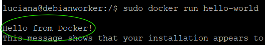
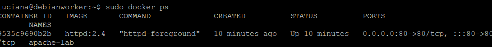
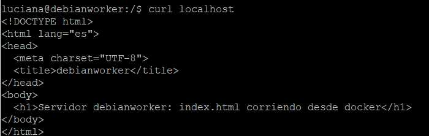

# 02 - Apache en Docker: página estática que muestra el nombre del servidor

## Objetivo
Servir la misma página estática del escenario 1, pero desde un contenedor Docker

## Entorno
| VM | IP | SO | Rol |
|----|----|----|-----|
| debianworker | 192.168.84.131 | Debian 13 | Host Docker con index.html en contenedor |

## Pasos

### Paso 1: título del paso

1. Instalar Docker: 
```bash
   sudo apt install -y docker.io
```
2. Comprobar que se instaló y está corriendo:
```bash
   sudo docker run hello-world
```

   

3. Crea el index.html con el nombre del server:
```bash
   tee ~/lab02/html/index.html > /dev/null <<EOF
    <!DOCTYPE html>
    <html lang="es">
    <head>
    <meta charset="UTF-8">
    <title>$(hostname)</title>
    </head>
    <body>
    <h1>Servidor: $(hostname)</h1>
    <p>Servido por Apache dentro de un contenedor Docker</p>
    </body>
    </html>
    EOF
```
4. Levanta Apache en el contenedor para que sirva el index.html:
```bash
   sudo docker run -d --name apache-lab -p 80:80 -v ~/var/www/html:/usr/local/apache2/htdocs:ro httpd:2.4
```
5. Verifica que el contenedor esté corriendo: 
```bash
   sudo docker ps
```

6. Verifica desde local que Apache responda sirviendo el index.html:
```bash
   curl localhost
```


7. Desde el navegador del host:


### Paso 2: título del paso

## Verificación
Cómo comprobé que funciona.


## Problemas y soluciones
**Síntoma:** El puerto 80, necesario para levantar el contenedor, no estaba disponible.
**Diagnóstico:** Verifiqué por quién estaba siendo ocupado el puerto usando `sudo ss -tlnp | grep ':80 '`.
**Causa:** El puerto estaba ocupado por el Apache instalado fuera del contenedor.
**Solución:** Desactivé Apache con `sudo systemctl stop apache2` y con `sudo systemctl disable apache2` y dejé el puerto libre para el Apache que iba a correr dentro del contenedor para servir el index.html.

## Qué aprendí
- Dos diferentes procesos no pueden escuchar en el mismo puerto. O desactivamos un proceso, o lo configuramos para que escuche en un puerto diferente.
- La imagen de Apache que corre dentro del contenedor, busca los archivos estaticos desde /usr/local/apache2/htdocs, no desde /var/www/ como lo hace el Apache instalado directamente en la VM. Así que tuve que tomar el index.html desde /var/www/ y "moverlo" a /usr/local/apache2/htdocs dentro del contenedor, así la imagen oficial de Apache que corre en el contenedor lo rescata de la dirección adecuada para servirlo.
