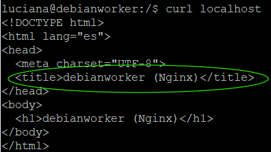

# NN - Título del escenario
Página estatica con Nginx

## Objetivo
Servir una página estatica con Nginx, en lugar de Apache

## Entorno
| VM | IP | SO | Rol |
|----|----|----|-----|
| debianworker |192.168.84.131/  | debian 13 | worker |

## Pasos

### Paso 1: título del paso

1. Desinstala Apache:
```bash
   sudo apt purge -y apache2
```
2. Elimina los paquetes de Apache:
```bash
   sudo apt autoremove -y
```
3. Verifica el estado del sistema (Apache):
```bash
   systemctl status
```
4. Verifica si el puerto 80 está siendo ocupado:
```bash
   sudo ss -tlnp | grep ':80'
```
5. Instala Nginx:
```bash
   sudo apt install -y nginx 
```
6. Verifica el estado del servicio:
```bash
   systemctl status nginx
```
7. Verifica cual servidor web está respondiendo:
```bash
   curl -I localhost
```
8. Verifica que Nginx sirve el index desde local:
```bash
   curl localhost
```
   
9. Desde el navegador del host:
    


## Problemas y soluciones
**Síntoma:** 
**Diagnóstico:**
**Causa:** 
**Solución:**

## Qué aprendí
-