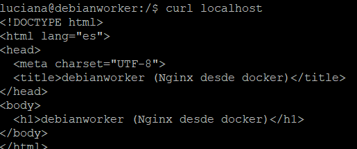
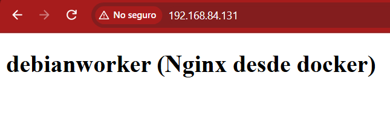

## Página estatica con Nginx y docker

Objetivo: servir una página estatica desde un contenedor con Nginx

## Pasos

1. Levanta un contenedor con la imagen de Nginx para que escuche en el puerto 80 y sirva el index.html:
```bash
   sudo docker run -d --name nginx-lab -p 80:80 -v /var/www/html:/usr/share/nginx/html:ro nginx:stable
```
2. Verifica el index servido por Nginx desde local:
```bash
   curl localhost
```


3. Desde el navegador del host:




## Problemas y soluciones

**Síntoma:** Al hacer 'curl localhost', Nginx del contenedor no servia el index.

**Diagnóstico:** Verifiqué con un 'sudo ss -tlnp | grep ':80' por quién estaba siendo ocupado el puerto 80, y figuraba que por el contenedor docker.

**Causa:** Al final descubrí con un 'sudo docker ps', que nginx del contenedor escuchaba en el puerto 8080, no en el 80.

**Solución:** Configuré Nginx del contenedor para que escuche en el puerto 80, el por defecto y luego sirvió con exito el index en el puerto 80.

## Qué aprendí
